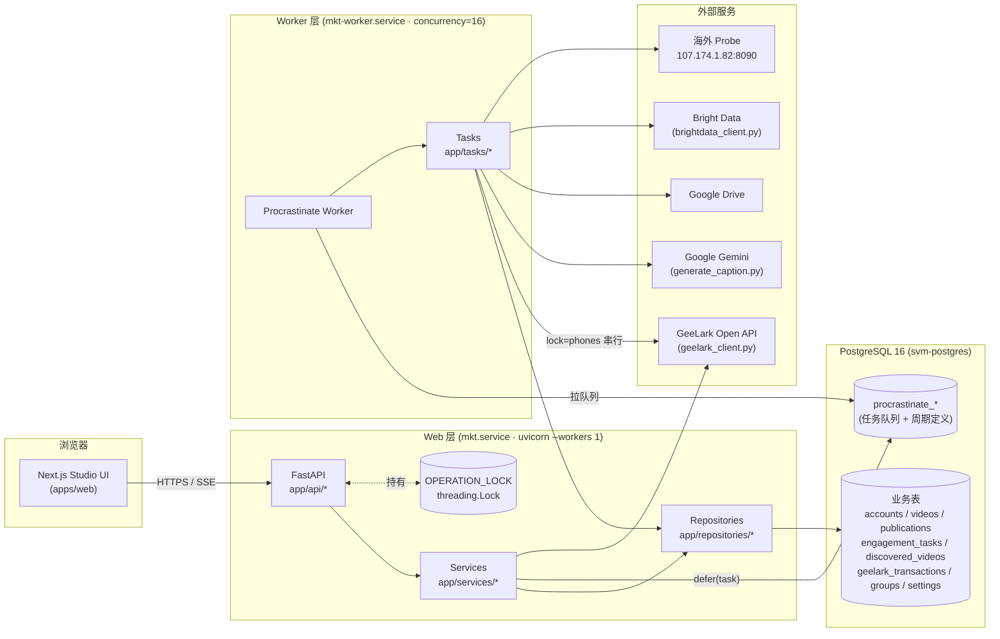

# GeeLark Studio

> 面向 TikTok / YouTube / Instagram / Facebook 多平台的 GeeLark 云手机账号运营控制台。
> 本目录是 FastAPI API + Procrastinate Worker + PostgreSQL；Studio 前端已并入 `apps/web`，把"养号 → 发布 → 互动 → 计费"全流程串起来。

---

## 这个项目是做什么的

营销团队在 GeeLark 云手机上批量运营海外短视频账号。手工去 GeeLark 桌面端点几百次完全不现实，所以这个项目把所有重复动作搬到一个面板里：

- **账号管理** — 从 GeeLark 批量拉环境进库；设代理、登录状态可视化；按"组"管理。
- **养号（Warmup）** — 一次性把整组账号挂上 GeeLark 的预热流程，按次计数（默认 10 次即视为养成），云手机有 `lock="phones"` 串行约束，杜绝并发烧钱。
- **发布（Publishing）** — 上传视频（本地 / 谷歌云盘导入），按 2 小时冷却分配到账号，自动调 Gemini 生成 caption，提交 GeeLark RPA 任务，后台轮询结果直至 SUCCESS / FAILURE。
- **互动（Engagement）** — 输入一批 TikTok 视频链接（或用关键词通过 BrightData 自动发现），让账号去 like / comment；评论可以选 GeeLark AI、Studio AI（Gemini）、或预设池。
- **计费审计（Costs）** — 把 GeeLark 的 transaction 流水拉到本地，按业务（warmup / publish / engagement）归因，一眼看出哪种动作花了多少美金。
- **代理健康** — 通过部署在海外 VPS 的 probe 服务，每天 04:00 检测每个账号的代理是否还能出墙，异常账号在面板高亮。
- **发现（Discovery）** — 每周抓一次 BrightData，按 IELTS 等关键词扩充候选视频池，供互动任务挑链接用。

---

## 技术栈

| 层 | 选型 |
|---|---|
| Web 后端 | Python 3.11 · FastAPI · SQLModel · uvicorn（强制 `--workers 1`）|
| 异步任务 | Procrastinate（PostgreSQL 为消息总线）· `lock="phones"` 串行化云手机操作 |
| 数据库 | PostgreSQL 16 · Alembic 管 schema |
| 前端 | Next.js 15 · React 19 · TypeScript，位于 `apps/web` 的 Studio 路由与组件 |
| 外部 API | GeeLark Open API · Google Gemini · Google Drive · Bright Data · 自建海外 probe |
| 部署 | systemd（`mkt` + `mkt-worker` 双 unit）· 生产 PG 跑在 docker 容器 `svm-postgres` |
| 依赖管理 | uv（Python）· pnpm（Node，monorepo 根 workspace）|

---

## 系统架构图



**两进程模型的关键约束：**

- Web 层必须 `--workers 1` —— `app/locks.py:OPERATION_LOCK` 是进程内 `threading.Lock`，多 worker 会各自持锁，导致 stop-all-phones、create-profiles 这类动作并发去调 GeeLark，烧钱出竞态。
- Worker 通过 Procrastinate 的 `lock="phones"` PG 通告锁串行化所有触发云手机的任务，这条锁是跨进程的，所以 Worker 本身可以扩多实例（目前生产只跑一个）。

---

## 模块布局

```
app/
├── api/                        路由层（薄，只做校验 + 转发）
│   ├── accounts.py             账号 CRUD、批量导入、批量操作
│   ├── videos.py               上传 / Drive 导入 / 触发发布 / 列表
│   ├── groups.py               组 CRUD、组内批量建机 / 养号 / 发布
│   ├── engagement.py           互动任务 CRUD、查询、撤回
│   ├── caption_prompts.py      Caption Prompt 模板库（按组绑定）
│   ├── comment_prompts.py      Comment Prompt 模板库
│   ├── costs.py                GeeLark 费用流水、按业务归因
│   ├── wallet.py               账户余额 / 充值记录
│   ├── dashboard.py            最近活动 / SSE / job runs
│   ├── settings.py             配置读写 + Gemini 模型选择 + 秘钥
│   └── health.py               /healthz（无鉴权，DB + Worker 探活）
├── services/                   业务逻辑
│   ├── geelark_service.py      建环境、stop_all_phones
│   ├── warmup_service.py       养号循环 + lease 机制
│   ├── posting_service.py      发布 / 提交 GeeLark / 解析 caption prompt
│   ├── assignment.py           视频 → 账号分配（2h 冷却）
│   ├── engagement_service.py   互动任务编排（点赞 / 评论）
│   ├── discovery_service.py    BrightData 关键词发现
│   ├── tiktok_metadata.py      TikTok 视频元数据抓取（标题 / 作者）
│   ├── thumbnail_service.py    视频缩略图生成
│   ├── groups_service.py       组 CRUD + 计数 + 关联 prompt
│   ├── platforms.py            平台集合 + 列映射的单一来源
│   ├── drive_import.py         Google Drive 视频导入（走 SSH 代理）
│   ├── proxy_check_service.py  代理健康检查（调海外 probe）
│   ├── proxy_intake.py         代理解析 / 校验
│   ├── credentials_parser.py   批量账号导入的凭据解析
│   ├── caption_prompts_service.py    Caption 模板服务
│   └── comment_prompts_service.py    Comment 模板服务
├── repositories/               SQLModel 查询层（无业务逻辑）
│   └── accounts / videos / publications / groups / settings /
│       engagement / discovered_videos / eligible_phones /
│       transactions / job_runs / caption_prompts / comment_prompts
├── tasks/                      Procrastinate 任务（Worker 进程执行）
│   ├── warmup.py               按账号触发的养号任务
│   ├── daily_warmup.py         每日全量养号扫描
│   ├── auto_publish.py         扫描 PENDING publications（0 * * * *）
│   ├── proxy_check.py          每日代理健康检查（0 4 * * *）
│   ├── publish.py              on-demand 发布 + 状态回查
│   ├── engagement.py           互动任务执行 + 评论生成
│   ├── discover_tiktok.py      BrightData 视频发现
│   ├── backfill_thumbnails.py  历史视频缩略图补齐
│   ├── idle_phone_sweeper.py   清扫闲置但仍在跑的云手机
│   └── sync_transactions.py    GeeLark 费用流水同步
├── auth.py                     HMAC Cookie 鉴权
├── config.py                   环境变量 + SETTINGS_DEFAULTS
├── db.py                       SQLAlchemy 引擎 + Session 工厂
├── locks.py                    OPERATION_LOCK（进程内）
├── models.py                   SQLModel 表定义
├── sse.py                      Server-Sent Events 工具
└── main.py                     create_app() API 工厂

alembic/                        Alembic 迁移
brightdata_client.py            Bright Data API 封装
geelark_client.py               GeeLark Open API 封装（唯一的 HTTP 出口）
generate_caption.py             Gemini caption 生成（PROMPT_TEMPLATE / sanitize）
generate_comment.py             Gemini 评论生成
scripts/                        一次性脚本（迁移、回填、BD 快照入库）
probe/                          海外 VPS 上的代理 probe 服务
docs/production-deploy.md       生产部署运行手册
systemd/                        生产环境 systemd unit
data/                           上传视频 / 缩略图 / RPA 截图（git 忽略）
```

Studio 前端入口位于 `apps/web/app/[locale]/(app)/studio/`，共享组件位于
`apps/web/components/studio/`。本目录中已不存在可构建的 Vite 前端。

---

## 数据模型

| 表 | 用途 |
|---|---|
| `accounts` | 一个账号 = 一台 GeeLark 云手机，含各平台登录态、`last_posted_at_*`、`warmup_count` / `target_warmup_count` 等 |
| `groups` | 账号分组；关联 `caption_prompt_id` 实现按组定制 caption |
| `videos` | 原始视频资产（路径、时长、缩略图、media_kind） |
| `video_assets` | 视频副资产（如多段 / 配图） |
| `publications` | 视频 × 平台一行；存放当前发布状态（`PENDING` → `QUEUED` → `INITIATED` → `SUCCESS` / `FAILURE`）、GeeLark 任务 id、失败截图、重试计数 |
| `publication_attempts` | 每次发布尝试的审计追踪（stage / source / message / error_code） |
| `engagement_tasks` | 互动任务定义（动作、目标链接池、评论模式、概率） |
| `engagement_runs` | 互动任务在单个账号 × 单个目标上的一次执行结果 |
| `discovered_videos` | BrightData 关键词发现的候选 TikTok 视频 |
| `caption_prompts` / `comment_prompts` | 可命名复用的 Prompt 模板 |
| `geelark_transactions` | 本地镜像的 GeeLark 计费流水（按 env_id × 时间归因业务） |
| `settings` | 键-值配置（养号目标、冷却、关键词、Gemini 模式 …） |
| `job_runs` | 后台 job 执行审计 |
| `procrastinate_*` | Procrastinate 自有表（jobs / events / periodic_defers / workers） |

GeeLark 任务状态约定（出自 `geelark_client.py`）：`2 = running`、`3 = done`、`4 = failed`、`7 = cancelled/unknown`。文件类操作两步走：`get_upload_url` → `PUT binary` → 把 `resourceUrl` 传给 GeeLark 业务接口。`/upload/getUrl` 只接受 `mp4 / jpg / jpeg / png`，`mov / m4v` 在客户端层归一化为 `mp4`。

---

## 后台任务清单

| 任务 | 触发方式 | 用途 |
|---|---|---|
| `warmup_account` | 事件触发（账号变 eligible） | 单账号养号一次，GeeLark status=3 → `warmup_count++`，到 `target_warmup_count` 即视为养成 |
| `daily_warmup_scan` | 周期 cron（每日） | 全量扫描，把符合条件的账号 defer 出 `warmup_account` |
| `auto_publish_scan` | `0 * * * *` | 扫 PENDING publications，按冷却分配账号并 defer `publish_publication_task` |
| `publish_publication_task` | 按需 | 实际向 GeeLark 提交一次发布 RPA |
| `check_publication_task` | 按需 / 周期回查 | 轮询 GeeLark 任务状态直至终态 |
| `proxy_check` | `0 4 * * *` | 每日通过海外 probe 检测每个账号代理是否可达 |
| `discover_tiktok` | 周期（每周一） | BrightData 关键词触发 → 拉结果 → 入 `discovered_videos` |
| `engagement_*` | 按需 | 执行点赞 / 评论；评论文本由 Gemini 或预设池产出 |
| `backfill_thumbnails` | 一次性 / 手动 | 历史视频缩略图补齐 |
| `idle_phone_sweeper` | 周期 | 清扫已经闲置但 GeeLark 端仍在跑的云手机（防漏停） |
| `sync_transactions` | 周期 | 拉 GeeLark 计费流水入本地 |

---

## 关键数据流

### 1. 发布一条视频

```
用户在 /videos 上传
    ↓
videos.py /api/videos/upload  →  写 videos 表
    ↓
（按平台勾选发布）→  写 publications (result=PENDING)
    ↓
[Worker] auto_publish_scan  每小时扫 PENDING
    ↓
assignment.build_pool（排除 2h 内已发的账号）
    ↓
posting_service._resolve_caption_config（取组级 caption_prompt；无全局回退）
    ↓
generate_caption.py → Gemini API
    ↓
posting_service.submit_publication_to_geelark
    ↓
geelark_client.publish_video  →  返回 GeeLark task_id
publications.result = QUEUED / INITIATED
    ↓
[Worker] check_publication_task  轮询 GeeLark
    ↓
最终 result ∈ {SUCCESS, FAILURE}；失败时记录 fail_code + fail_screenshot
```

### 2. Caption 生成

每个 `groups` 必须绑定一个 `caption_prompts.id`，prompt 文本即 caption brief —— **没有全局回退**，未绑定则 `_resolve_caption_config` 抛 `CaptionPromptMissingError`，发布在 `auto_publish_scan` 时就被跳过。设置 `gemini_high_quality=1` 时 Gemini `thinking_budget=4096`。生成结果走 `sanitize_caption()` 去 Markdown、去 preamble、按 `max_len=220` 截断并保留 hashtag 尾巴。

### 3. 互动任务

```
用户在 /comments 创建 EngagementTask（目标链接 + 动作 + 评论模式）
    ↓
engagement_service 按账号池 fan-out 出 engagement_runs
    ↓
[Worker] engagement task  →  geelark_client.run_engagement
    ↓
评论模式分支：
  · geelark_ai   → GeeLark 自带 AI 评论
  · studio_ai    → 本地 Gemini（generate_comment.py）生成后再投
  · provided     → 从预设池随机抽
    ↓
回写 engagement_runs.result / cost / result_screenshot
```

---

## 环境变量

| 变量 | 必填 | 说明 |
|---|---|---|
| `DATABASE_URL` | ✓ | `postgresql+psycopg://user@host:port/dbname` |
| `RADAR_AUTH_VERIFY_URL` | ✓ | Radar 工作空间会话校验入口；本地通常为 `http://127.0.0.1:3000/api/workspace/session` |
| `WORKSPACE_SECRETS_KEY` | ✓ | 工作空间凭据 AES-256-GCM 主密钥；必须单独备份，错误值会 fail closed |
| `GEELARK_CALLBACK_TOKEN` | 生产必填 | GeeLark callback 共享 token；为空会关闭 callback |
| `GEELARK_TOKEN` / `GEMINI_API_KEY` | 迁移兼容 | 正常由 leader/admin 在 Studio 中按工作空间配置；env 值仅供迁移脚本兼容 |
| `GEMINI_PROXY` | 可选 | Gemini 专用 HTTP 代理；为空时退回 `DRIVE_IMPORT_PROXY` |
| `DRIVE_IMPORT_PROXY` | 可选 | Drive 导入 HTTP 代理；同时是 Gemini 的回退代理 |
| `PROBE_URL` / `PROBE_TOKEN` | 可选 | 海外代理探测端点 + 鉴权 token；为空则代理列状态保持灰色 |
| `RPA_WATCHDOG_BASE_URL` | 启用 Watchdog 时必填 | Ops 后端代理到独立 watchdog；每个请求使用当前 workspace 自己的加密 `GEELARK_TOKEN` |
| `RPA_WATCHDOG_TIMEOUT_SECONDS` | 可选 | Studio 调 watchdog 的 HTTP 超时，默认 8 秒 |
| `BRIGHTDATA_TOKEN` | 可选 | Bright Data API token；为空则 Discover 功能不可用 |
| `BRIGHTDATA_KEYWORD_DATASET_ID` | 可选 | BrightData TikTok 关键词数据集 id |

> **No Google Sheets.** 旧版的 Sheets 集成已彻底移除，不要再装 `gspread` / `googleapiclient`。

---

## 本地起步

### 1. Python 环境

安装 [uv](https://docs.astral.sh/uv/)：

```bash
brew install uv               # macOS
# 或 curl -LsSf https://astral.sh/uv/install.sh | sh
uv sync                       # 生成 .venv + 装依赖
```

### 2. PostgreSQL

需要本地 PG 16+，开两个库：

```bash
createdb mkt_dev
createdb mkt_test            # tests/conftest.py 强制库名要含 "test"
```

### 3. 配置 `.env`

```bash
cp .env.example .env
# 然后按上表把各项填好
```

### 4. Schema 迁移

```bash
uv run alembic upgrade head
DATABASE_URL=postgresql+psycopg://<user>@127.0.0.1:5432/mkt_test \
  uv run alembic upgrade head
```

---

## 运行

### Radar Web（仓库根目录，终端 1）

```bash
pnpm install
pnpm --filter web dev
```

访问 `http://localhost:3000`，注册方式由 Radar 的 `REGISTER_MODE` 控制。不要使用
`apps/studio/run.sh`：它仍引用已删除的 Vite 前端，待单独清理。

### Studio API（`apps/studio`，终端 2）

```bash
uv run uvicorn app.main:app --host 127.0.0.1 --port 8080 --workers 1
```

### Worker（`apps/studio`，终端 3）

```bash
uv run python -m procrastinate -a app.tasks.procrastinate_app worker --queues phones,default
```

没有 Worker 也能进面板，但所有异步操作（养号 / 发布 / 互动 / cron）都不会动。生产用 systemd unit `mkt-worker` 跑，`--concurrency=16`。

---

## 测试与 Lint

```bash
uv run pytest -q                # 全量 Studio 测试
uv run pytest tests/foo.py::test_bar -v   # 单个用例
uv run ruff check .             # Lint
```

---

## 生产部署

线上跑在阿里云 `139.196.52.92`，路径 `/opt/mkt`，systemd 双 unit `mkt` + `mkt-worker`，PG 在 docker 容器 `svm-postgres`。完整发布顺序以仓库根目录 [部署 Runbook H 节](../../docs/DEPLOY.md#h-当前全量发布流程核验于-2026-07-29) 为准；[Studio 部署补充](docs/production-deploy.md) 负责 tarball、`alembic upgrade head`、systemd 与 ingress 细节。**Schema 变更必须走 Alembic**；破坏性变更前先做可验证的 `pg_dump -Fc`。

---

## 重要约定

- **Web 层 `--workers 1` 是硬约束。** 本地命令和 systemd unit 都不得改为多 worker。
- **跑云手机就在烧钱。** 任何启动云手机的代码路径必须保证在所有 exit path 上把手机停掉。`/api/phones/stop-all` 是兜底，但不要依赖它。
- **发布是 fire-and-forget。** Service 层只负责把 RPA 任务提交给 GeeLark，结果由 Worker 通过 `check_publication_task` 异步收敛。
- **2 小时账号发布冷却。** 通过 `post_cooldown_hours` 设置可调，由 `assignment.build_pool` 强制。
- **Schema 走 Alembic。** 不要手 patch 表；新增列就加一个 `op.add_column` 迁移。
- **`geelark_client.py` / `generate_caption.py` / `generate_comment.py` / `brightdata_client.py` 是顶层复用模块**，被 `app/services/` 直接 import。重组目录前先改 import。
- **Studio UI 已并入双语 Radar Web。** 文案和路由改动应在 `apps/web` 按现有 i18n 约定完成。
- **每次改动都提交。** 不要把改好的文件挂在工作区或暂存区跨任务；用显式路径 `git add path/to/file` 而不是 `git add .`。
- **生产发布是受控操作。** 仅在明确的发布窗口按根目录 `docs/DEPLOY.md` H 节执行，先备份和迁移，再按 Scraper → Studio → Web 顺序发布并冒烟。

---

## 相关文档

- [docs/production-deploy.md](docs/production-deploy.md) — 生产部署 runbook
- [GUIDE.md](GUIDE.md) — 给运营同事看的功能使用指南
- [CLAUDE.md](CLAUDE.md) / [AGENTS.md](AGENTS.md) — 给 AI 编程助手看的项目约定（保持互相同步）
